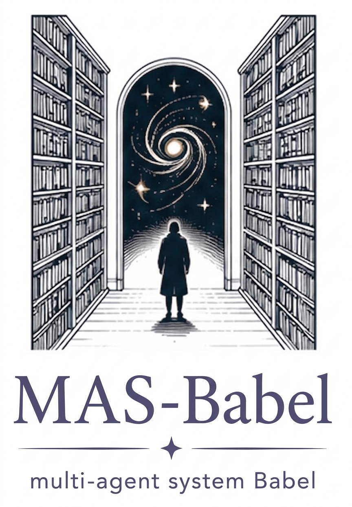

<table>
<tr>
<td width="260" valign="top">
  
</td>
<td valign="top">

# MAS-Babel

Multi-agent system (MAS) Babel is a tool for designing multi-agent architectures and orchestration patterns (sometimes referred to as *topologies*) for scientific applications. It helps you compose agent roles (e.g., *designer*, *critic*, *adversary*, *judge*, *self-critic* etc.), run topology-driven reasoning loops, and compare coordination patterns in a reproducible way. The main goal of MAS-Babel is an AutoGen-powered library of widely used multi-agent architectures that can be tested, bechmarked and further assembled into custom MAS pipelines for science applications.

</td>
</tr>
</table>

## Implemented MAS Architectures

Currently implemented:

- **single**: a single agent baseline for testing.
- **self_reflection**: a single agent that critiques and revises its own output.
- **peer_review**: a two-agent system, where the *architect* generates an output and the *reviewer* provides feedback. 
- **adversarial**: a two-agent system, where the *architect* generates an output, which is then challenged by an *ardversary* agent for N rounds until a satisfactory output is generated.
- **parallel_ensemble**: multiple expert agents work in parallel, with the *judge* agent revieving and synthesising the final output.

In progress: 

- **Planner-executor(s)**: a multi-agent system witha *planner* agent decompsing a task into subtasks with a single or multiple *executors* then executing the assigned tasks. 
- **Agent ensemble**: multiple expert agents generate outputs with the final output chosen by majority vote.
- *...*

## Design Philosophy

Instead of hardcoding complex black-box MAS systems that is difficult to debug and modify, MAS-Babel provides the minimal building blocks that the end users can integrate into their custom pipelines. 

## Scientific Applications

MAS-Babel is designed to support scientific and research workflows where reliability, traceability, and iterative feedback matter. Typical use cases include:
- Scientific hypothesis formulation, data analysis, paper draft writing
- Literature review with a feedback loop to avoid halucinated content, references, etc. 
- Reproducing peer-reviewed research papers
- Machine learning algorithm optimization (e.g., iteratively choosing an optimal CNN architecture)

## Repository Contents

- src/mas_topologies/topologies/
  Core source code: multi-agent architecture (*topology*) implementation.

- src/mas_topologies/tasks/ml_architect/
  Task-specific wrapper for ML architecture design (context building and response parsing).

- examples/
  A number of example notebooks illustrating the core functionality of the library.

- tests/
  Unit tests for agent dispatch, context, logging, and topology behavior.

## Installation

Requirements:
- Python 3.10+

Install in editable mode:

    pip install -e .

Optional development dependencies:

    pip install -e ".[dev]"

## Quick Start

Run one of the demos at:

- examples/

## Roadmap

- Expand the MAS architecture catalog to cover additional orchestration patterns (e.g., a planner agent + multiple executor agents).
- Apply to scientific programming problem benchmarks, such as SciCode.
- Apply to science problem benchmarks, e.g., TPBench (theoretical physics problems)
- Apply to peer-reviewed paper reproduction benchmarks, e.g., Replicationbench.

## License

MIT